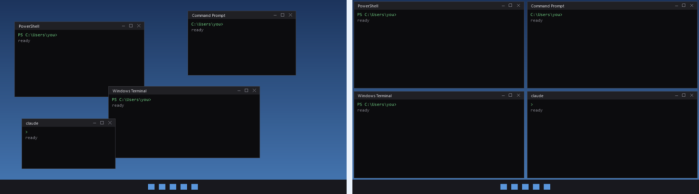
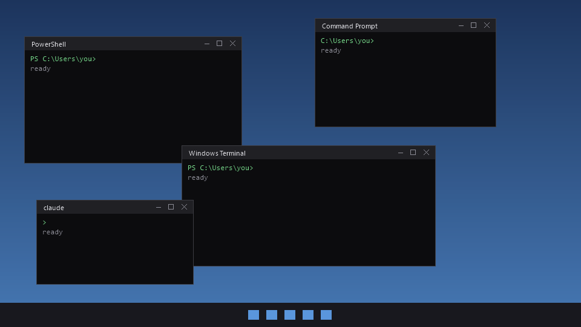

# Tidy Terminals

One keypress snaps all your terminal windows into an even grid on your main monitor, however many are open.

Windows Snap only offers a few fixed layouts. If you run a pile of Claude Code, PowerShell or cmd windows, resizing them by hand gets old fast. This does it in one keypress, with no learning curve.

## Two versions

The download comes with two versions. One install sets up both, and each has its own hotkey and Desktop icon, so you pick fast or fun every time.

| | **Tidy Terminals** | **Aqua Tidy** |
| --- | --- | --- |
| Hotkey | **Ctrl+Alt+T** | **Ctrl+Alt+A** |
| Desktop icon | Tidy Terminals | Aqua Tidy (her face) |
| What you see | Windows jump into the grid instantly | Little pixel Aquas carry each window into place and resize it |
| Time | Instant | A few seconds (Esc skips to the end) |
| Grid | Same | Same |

### Tidy Terminals (instant)



- Finds every **Windows Terminal**, **Command Prompt** and **PowerShell** window that the current user can move.
- Tiles them into a grid sized to the count: 2 side by side, 4 in 2x2, 6 in 2x3, 9 in 3x3. A partly filled last row stretches to the full width.
- Restores minimized or maximized windows first.
- Accounts for Windows' invisible window borders so edges line up cleanly.
- Skips any window titled `agentview` (see [Customizing](#customizing)).
- Runs hidden: no console flash.

### Aqua Tidy (fun mode)




Up to three little pixel Aquas pop in with a sparkle and get to work:

1. Each one walks over to a terminal, flies up and grabs it by the title bar.
2. She carries it into its spot in the grid.
3. She flies down to its bottom-right corner and drags it out (or in) to the right size.
4. She grabs the next window nobody has taken yet. When all the windows are done, she does a victory pose with a heart and poofs away.

If everything is already tidy, one Aqua shows up and celebrates anyway.


- Press **Esc** at any time, or wait 20 seconds, and every window still in flight snaps straight into place.
- The overlay is click-through, so she never blocks your mouse.
- If anything goes wrong, it logs to `%LOCALAPPDATA%\AquaTidy\aqua-tidy.log` and falls back to the instant tidy, so your windows still end up in place.
- The first run takes a second or two longer while the animation engine compiles. It is cached after that.

Fan art of Aqua from KonoSuba, hand-drawn in pixels for this tool.

## Requirements

- Windows 10 or 11
- Windows PowerShell 5.1 (built in)

Nothing else to install. Both versions use only what ships with Windows.

## Download and install

1. Get the files, either way works:
   - **Git:** `git clone https://github.com/jlee056/tidy-terminals.git`
   - **ZIP:** click **Code > Download ZIP** on GitHub, then extract it.

   Put the folder somewhere permanent. The shortcuts point at it.
2. Open a normal PowerShell window (not as administrator) in that folder and run:

   ```powershell
   Get-ChildItem -Recurse | Unblock-File    # only needed for the ZIP download
   powershell -ExecutionPolicy Bypass -File .\install.ps1
   ```

That puts **two icons on your Desktop**, **Tidy Terminals** and **Aqua Tidy**, and adds a background listener at login for both hotkeys, **Ctrl+Alt+T** and **Ctrl+Alt+A**. No administrator approval is needed.

The hotkeys start working at your next sign-in. To start them right away, double-click `hotkey-listener.vbs` in Explorer.

Run either version again after opening more terminals.

### Administrator windows

Windows only lets an elevated program move elevated windows. The shortcuts and hotkeys run without elevation, so they skip terminals opened "as administrator." If you need to tile those too, run the instant version from an elevated PowerShell window:

```powershell
powershell -NoProfile -ExecutionPolicy Bypass -File .\tidy-terminals.ps1
```

## Files

| File | Version | Purpose |
| --- | --- | --- |
| `tidy-terminals.ps1` | Tidy Terminals | The grid logic (Win32 calls via `Add-Type`) |
| `tidy-terminals.vbs` | Tidy Terminals | Runs it with no visible window |
| `run-tidy-task.vbs` | Tidy Terminals | Legacy-named launcher used by older Desktop shortcuts |
| `aqua-tidy.ps1` / `.vbs` | Aqua Tidy | Launcher. Compiles the engine once and caches it in `%LOCALAPPDATA%\AquaTidy` |
| `AquaTidy.cs` | Aqua Tidy | Overlay, animation, carrying and resizing |
| `aqua-sprites.txt` | Aqua Tidy | Palette, sprite layers and frames, as text art |
| `aqua.ico` | Aqua Tidy | Desktop icon |
| `hotkey-listener.ps1` / `.vbs` | Both | Hidden background listener for Ctrl+Alt+T and Ctrl+Alt+A |
| `install.ps1` | Both | Creates both Desktop icons and adds the listener to Startup |
| `docs/` | README | Pictures for this page |

## Customizing

Edit the top of `tidy-terminals.ps1` (the Aqua version uses the same grid):

- `$gap` sets the pixel gap between windows (default 4). For Aqua Tidy, change `Gap` in `AquaTidy.cs` to match.
- The `agentview` check excludes windows you want left alone. Change the title match to any window you don't want moved.

Both versions tile on the **primary** monitor's work area (the screen minus the taskbar).

### Editing Aqua

Her art is plain text in `aqua-sprites.txt`: each frame is 24 x 32 pixels, one character per pixel, with the colors listed at the top. After editing:

```powershell
.\aqua-tidy.ps1 -Preview sheet.png    # every frame side by side, to check your art
.\aqua-tidy.ps1 -MakeIcon             # rebuild aqua.ico
.\aqua-tidy.ps1 -Demo frames          # render the demo animation as PNG frames (no real windows move)
```

## Troubleshooting

If another program already owns one of the hotkeys, the listener shows a message saying so. Change the key in `hotkey-listener.ps1` (`0x54` is T, `0x41` is A), then restart the listener or sign out and back in.

## Uninstall

```powershell
$desk = [Environment]::GetFolderPath('Desktop')
Remove-Item "$desk\Tidy Terminals.lnk", "$desk\Aqua Tidy.lnk"
Remove-Item -Recurse "$env:LOCALAPPDATA\AquaTidy" -ErrorAction SilentlyContinue
```

Then delete the `Tidy Terminals Hotkey` shortcut in your Startup folder (`shell:startup`), end any `powershell` process running `hotkey-listener.ps1`, and delete this folder. Older installations may also have a scheduled task named `Tidy Terminals`. If yours does, remove it from an elevated PowerShell window.

## License

[MIT](LICENSE)
